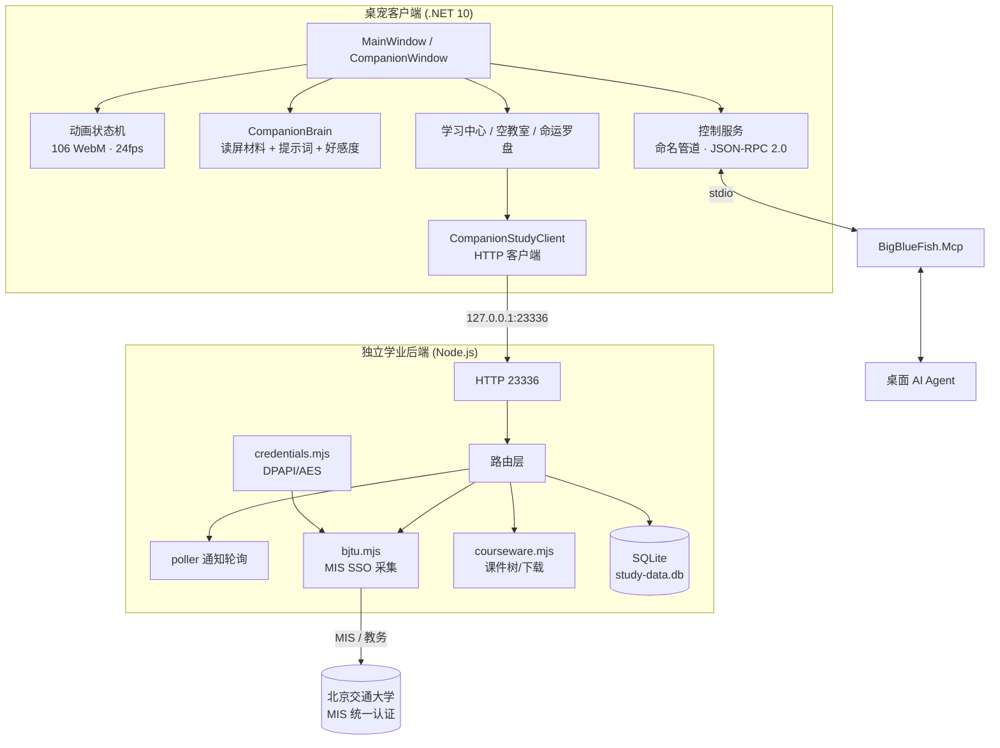

# 北交大肥鱼 · youkeding-pet

<div align="center">

**一只读懂屏幕、陪你上班、还能帮你盯作业与课表的鲸鱼娘桌宠。**

_基于开源桌宠「蓝色大肥鱼（Big Blue Fish Desktop Pet）」的深度本地化定制版_

[](docs/DEV.md)
[](#运行平台)
[](#技术架构)
[](#2-读屏理解与本地对话)
[](LICENSE)


</div>

> **隐私优先**：学号与密码只存本机，读屏内容不上传、不落盘，可完全离线使用。
>
> **开箱即用**：提供 Windows、Linux（x64 / arm64）、macOS（Intel / Apple Silicon）免安装绿色包，内置 Node 运行时与 .NET 自包含程序，解压即用——无需安装环境、无需管理员权限、不写注册表。
>
> 本项目与桌面壁纸项目 `fatty-fish-wallpaper` 完全独立，可分别克隆、分别运行、互不依赖。美术素材来自开源项目 `dsh-pet`（PC2005-cloud，MIT）等，详见 [THIRD-PARTY.md](THIRD-PARTY.md)。

---

## 项目是什么

**蓝色大肥鱼**是一款住在桌面上的 AI 鲸鱼娘桌宠。她有柔软的蓝色长发、女仆发饰、鲸鳍与尾巴，透明无边框地停在桌面边缘，可以拖动、缩放、点击互动。她通过 **OCR 读取当前屏幕内容**，交给**完全在本机运行的 4B 本地大模型**理解，然后在奶油色气泡里用亲切俏皮的口吻说一句话——关心你、给你加油、吐槽你写的代码。

在此开源底座之上，本项目进行了深度本地化定制，形成「**北交大肥鱼**」：把桌宠变成一位真正能用的**学习生活助理**——作业 DDL 与实验对账、课件批量下载、课表与课件联动、空教室查询、未读邮件与作业提醒，全部集成在统一设计语言的学习中心里；凭据只保存在本机，不上传云端。

一句话概括：**上游是「会读屏幕、会撒娇的桌宠」，本项目是「把校园教务系统装进桌宠里」。**

> 项目由两部分组成，同仓交付、可独立运行：
>
> | 组成 | 技术 | 职责 |
> |---|---|---|
> | **桌宠客户端** | .NET 10 / WPF（Windows）、Avalonia（Linux） | 角色渲染、106 段动画、本地推理、学习中心、命理、MCP 服务 |
> | **独立学业后端** | Node.js | HTTP 服务（默认 `127.0.0.1:23336`）、学业数据采集、通知轮询、SQLite / 知识库持久化 |
>
> 配套的赛博工友动态壁纸是**另一个独立项目**（`fatty-fish-wallpaper`），不在本仓库内。

---

## 目录

- [功能全景](#功能全景)
- [核心特性详解](#核心特性详解)
  - [1. 桌面陪伴与 106 段动作](#1-桌面陪伴与-106-段动作)
  - [2. 读屏理解与本地对话](#2-读屏理解与本地对话)
  - [3. 学习中心（北交大定制）](#3-学习中心北交大定制)
  - [4. 空教室自习](#4-空教室自习)
  - [5. 学业提醒与账号安全](#5-学业提醒与账号安全)
  - [6. 出鲸仙 · 命理与每日趣味](#6-出鲸仙--命理与每日趣味)
  - [7. 好感度系统](#7-好感度系统)
  - [8. MCP 与 Agent 联动](#8-mcp-与-agent-联动)
- [设计系统](#设计系统)
- [技术架构](#技术架构)
- [安全与隐私](#安全与隐私)
- [接口一览](#接口一览)
- [运行平台](#运行平台)
- [快速开始](#快速开始)
- [项目结构](#项目结构)
- [测试与调试](#测试与调试)
- [许可与致谢](#许可与致谢)

---

## 功能全景

```
桌面陪伴          读屏对话        学习中心          学业提醒
  │                 │               │                │
106 段动画      OCR + 4B 本地模型   作业 / 课件 / 课表   DDL 五档提醒
呼吸/哼歌/吃饭    前台内容理解       实验栏逐课对账     新邮件即时推送
点击/拖动/礼仪    天气 + 科技新闻    课表点课跳课件     新作业即时推送
节日/季节/三餐    无对话历史·不上云   勾选批量下载       本地去重基线
  │                 │               │                │
  └─────────────────┴───────────────┴────────────────┘
                       │
        ┌──────────────┴──────────────┐
   独立学业后端 (Node.js)         统一设计语言
   HTTP 23336 · SQLite           CompanionTheme
   学业采集 / 提醒轮询            浅色 · 大留白 · 胶囊标签
        │
  ┌─────┴──────┐
命理 · 好感度   Agent 联动
八字/六爻/梅花  8 个 MCP 工具 / 提线木偶模式
紫微/塔罗/运势  命名管道 JSON-RPC / 双击对话
```

### 桌宠日常

<p align="center">
  
  
  
</p>
<p align="center">
  
  
  
</p>

---

## 核心特性详解

### 1. 桌面陪伴与 106 段动作

鱼鱼内置 **106 段透明 WebM 动画**，以 24 帧/秒的片段时序播放，基础画布 640×360。她会呼吸、哼歌、伸懒腰、吃零食、玩魔方、撸猫、敲小电脑；到饭点认真吃饭，夜里 23 点后犯困打盹、刷牙，还会堆雪人、被落叶埋住、放烟花。

**动作选择不是随机轮询，而是一套经过精细调参的权重系统：**

| 动作池 | 用途 | 代表动作 |
|---|---|---|
| `Idle` | 待机轮换 | 待机呼吸休闲、悠闲哼歌、原地小憩沉眠（夜间限定） |
| `Event` | 日常事件（默认每 40 秒一次，可设 30–300 秒） | 三球抛接、可爱宅舞、鲸鱼吐泡泡、原地漂浮踏步 |
| `Click` | 点击回应 | 元气挥手、害羞惊讶、傲娇生气、挠痒咯咯笑 |
| `Greeting` / `Drag` | 启动/关闭礼仪、被拎起悬空 | 女仆屈膝礼仪、被鼠标拖拽悬空反馈 |
| `Daily` | 每日一次 | 晨间刷牙 |
| `Disabled` | 不参与自主随机，仅供 Agent 指定 | 余额系列、工作状态-垂头叹气 |

权重按固定顺序叠加计算：禁用/夜间/季节/移动门槛 → 基础权重 → 夏冬覆盖 → 早晨权重 → 节日权重 → 餐时增量。一段动作在没有交互打断时会**完整播完**再衔接下一段；点击、拖动、外部立即动作与退出是可打断的交互。

**节日与季节是一等公民：** 春节写福字放烟花、元宵吃汤圆、端午吃粽子、七夕穿针乞巧、中秋赏月吃月饼、腊八喝粥；公历 2·14、5·20、10·31、12·25 也各有专属动作。农历节日按 `ChineseLunisolarCalendar` 计算并正确处理闰月，节前权重随日期临近线性升高（`Triangle` 模式）。季节则带来堆雪人、落叶、消暑活动与螃蟹横着走。

- 启动：按时间段说「主人早上/中午/下午/晚上好，鱼鱼给主人请安啦~」并行 1.5 倍速屈膝礼；关闭时同样行礼道别。
- 位置：透明像素不占用点击区域（Windows 素材透明度命中测试 / Linux X11 输入形状），可见身体被限制在显示器工作区内，支持多显示器与 DPI 变化。
- 缩放 50%–200%；气泡尺寸独立缩放 50%–200%。

### 2. 读屏理解与本地对话

鱼鱼读取当前前台窗口画面，用 OCR 识别文字并按**顶部 / 左侧 / 正文 / 右侧 / 底部五区**整理（Windows 用系统 `Windows.Media.Ocr`，Linux 用 Tesseract；X11 与 Wayland 均支持），再交给本机 llama.cpp 运行的 **Qwen3.5-4B Q4_K_M GGUF** 模型理解。

- **首次开口**在启动约 45 秒后，之后从六档区间随机排下一次：2–3、3–5、5–8、10–16、15–23、20–30 分钟。
- 说话时挑你停下键鼠的间隙（空闲 8–600 秒），头边转起蓝色加载环，文字逐字出现在奶油色气泡里。
- 气泡停留 8 档可调：5 秒 / 10 秒 / 15 秒 / 30 秒 / 1 分钟 / 2 分钟 / 3 分钟 / 直到下一句。
- **没有对话历史，不保留记忆**：每次只提交 system + user 两条消息；读屏内容只在本机交给模型，不上传、不落盘。
- **天气**：按省/市/区县三级选点，每小时刷新 Open-Meteo，播报气温、体感、湿度、风力、最高最低温与降水概率。
- **科技新闻**：从 IT之家 RSS 抓取 48 小时内条目，开启公共信息时普通生成有 3% 概率讲一条新闻。
- **供电与全屏**：笔记本离电时自动停止推理并卸载模型（照顾续航）；外部程序全屏时自动躲开，结束后回来。

模型按设备可用显存自动调整计算缓冲（8192/4096/384 MiB 三档 fit-target），GPU 初始化失败自动回退 CPU 兼容模式；也支持在设置中填入 OpenAI 兼容的远程接口（三项齐全才生效，否则回到本地模型）。

### 3. 学习中心（北交大定制）

这是本地定制的核心：**三页式学习中心**，文字导航 + 首次切到才加载的懒加载设计。所有教务数据经本地学业后端以 MIS SSO 方式采集。

| 子页 | 能力 |
|---|---|
| **作业 DDL** | 统计块 + 类型筛选（全部 / 作业 / 实验 / 报告）+ 只看未交 + 剩余天数 + 逾期标红；双击作业行直达课程平台深链 |
| **课程课件** | 学期 → 课程 → 目录树 → 文件；勾选批量下载、全选、本机课件列表；原件优先、预览 PDF 兜底；双击本地文件用系统程序打开 |
| **课表** | 星期为列、节次/时间为行的表格化周视图；今日列极淡蓝底高亮；整学期课程全展示、非本周灰化；「只看本周」筛选 |

**几个经过反复打磨的细节：**

- **实验栏逐课对账**：平台把「实验 / 课程报告」也计入作业任务数。作业页对每门课核对 `作业栏 / 实验栏 / 报告栏`，让「平台自报任务数 = 三栏之和」，避免漏看实验里的作业。因为 `taskCounts` 没有独立的「实验」键，对账采用「平台自报 vs 三栏合计」的口径。
- **课表 ↔ 课件联动**：点击课表里的课程，直接跳到课件页并自动选中同一门课。关联依据是**课程代码精确匹配**（课表 `ScheduleEntry.code` = 课件 `CoursewareCourse.key`，如 `M319018B` = 密码学）；课程名去括号/标点后作为兜底。**不使用老师名匹配**——同一门课在课表与课件平台的任课教师可能不同。匹配不到会明确提示，不会误跳。
- **串行加载**：课表与课程列表会串行拉取，避免两次 SSO 并发互相顶号。
- **换号一致性**：关闭窗口重开时一律重新拉数据，并清空上一账号的课程、作业、课表缓存，杜绝「换号还看到别人的课」。

### 4. 空教室自习

独立的「空教室自习」窗口，直连北交大教务系统的教室占用表：

- 按**教学周 / 星期 / 节次区间（连续 N 节）/ 教学楼 / 教室名**筛选。
- 一次拉取全周约 397 间教室并做 10 分钟缓存，冷启动需重新登录（约 5–10 秒）。
- **颜色语义严格遵循教务原站**：`#fff` 空闲、`#e46868` 排课、`#9e6868` 调课、`#394ed6` 考试、`#77bf6d` 实验占用（注意：绿色是实验占用，**不是空闲**）、`#d8cc56` 其他。桌宠按原色渲染并提供图例。

### 5. 学业提醒与账号安全

- **提醒节奏**：作业在截止前 2 天、1 天、半天、2 小时、1 小时各提醒一次；**新布置的作业与新的未读邮件即时提示**。提醒通过本地基线去重，避免反复打扰。
- **账号只在本机**：学号密码以 **Windows DPAPI（CurrentUser）** 加密，失败降级 AES-256-GCM；写盘走 `.part → rename` 原子替换；`GET /study/account` 永不返回密码。
- **保存前先验证**：默认真实登录一次再落盘，验证失败返回 401 且**不覆盖旧凭证**；「测试登录」可只验证不保存，密码留空表示沿用已存密码。
- **教学周校准**：校历返回的学期起始日未必等于真正开课的那一周，可手填「教学第 1 周周一」对齐课表高亮（如 2026 秋为 `2026-09-14`）。
- 设置入口：桌宠右键 / 托盘 →「北交大肥鱼 → 账号设置…」，或浏览器打开 `http://127.0.0.1:23336/study/settings`。

> 当前学业模块**仅适配北京交通大学**，采集逻辑位于 `server/notify/bjtu.mjs`。接入其他学校需新增采集模块并让学校字段路由到对应实现。

### 6. 出鲸仙 · 命理与每日趣味

右键「出鲸仙」提供四件套，全部**本地规则计算，不上传出生信息**：

| 功能 | 说明 |
|---|---|
| **今日运势** | 摘取当天真实黄历生成一句话；无本地模型时也有模板兜底 |
| **塔罗抽牌** | 从内置牌库按牌位抽取，正逆位与牌义解读 |
| **事件命理** | 针对心中所问之事起卦解读 |
| **命运罗盘** | 四盘同启：**八字 / 六爻 / 梅花易数 / 紫微斗数**，独立 `BigBlueFish.Fate` 项目实现 |

另有「**今日打工**」播报陪伴记忆（睡觉、吃饭、工作等状态小结），「**今日热榜**」抓取知乎热榜（经公开聚合接口）挑一条讲给你听。

### 7. 好感度系统

点击、陪伴会累积亲密度，分五档并随语气注入对话（数字只用于内部判断，绝不写进 prompt）：

```
初识(0) ── 眼熟(50) ── 亲近(200) ── 挚友(500) ── 家人(1000, 满级)
```

好感度在右键菜单标题与托盘进度条中可见，点击可查看「当前档 · 距离下一档还差几分」的 ♥ 进度展示。语气会随亲疏档位逐渐亲近。

### 8. MCP 与 Agent 联动

标准版内置标准 MCP 接口，**默认关闭**，开启需确认权限弹窗。配置指向随包桥接程序 `BigBlueFish.Mcp.exe`（Linux: `/opt/bigbluefish/BigBlueFish.Mcp`）：

```json
{
  "mcpServers": {
    "big-blue-fish": {
      "command": "C:\\Program Files\\北交大肥鱼\\BigBlueFish.Mcp.exe",
      "args": []
    }
  }
}
```

Agent 可用 8 个工具：

| 工具 | 能力 |
|---|---|
| `get_settings` / `update_settings` | 读写设置、查看动作/队列/模型状态（McpEnabled 不可由 Agent 修改） |
| `list_actions` | 列出全部 106 个动作的精确名称与权重 |
| `capture_foreground` / `capture_screen` | 获取前台窗口或整个虚拟桌面 PNG 截图 |
| `play_action` / `interrupt_action` | 排队播放 / 立即播放指定动作 |
| `say` / `say_next` | 立即原文逐字显示 / 下次正常时机显示 |

- **提线木偶模式**：鱼鱼暂停自主说话与动作，循环待机呼吸，完全交给 Agent 驱动。
- **双击对话**：有 Agent 连接时双击鱼鱼展开输入框，文字经 MCP 推送给 Agent，由 Agent 通过 `say` 回复。
- **交互事件**：点击/拖动以 JSON-RPC 通知推送，供 Agent 消费。
- **无 MCP 版（Safe）**：编译时移除 MCP 服务、桥接程序、输入框与相关设置页，彻底消除截图外传风险。

---

## 设计系统

本地定制窗口共用一套设计 token（`CompanionTheme.cs`），并由桌宠、学习中心、空教室、命运罗盘、浏览器设置页一致引用，保证跨窗口视觉统一。

**设计原则（原文摘录）：** 浅色、克制、大留白。层级靠字号 / 留白 / 极淡分隔线表达；状态靠胶囊标签与细色条表达——**不用整行染色、不用密集边框、不用系统默认控件外观**。

### 色板

| 类别 | Token | 色值 | 用途 |
|---|---|---|---|
| 基础 | `Paper` / `Card` | `#FFFBFA` / `#FDFAF4` | 暖白纸面与卡片 |
| 文字 | `Ink` / `Muted` / `Subtle` | `#2A3853` / `#7E828E` / `#92969E` | 主文 / 次文 / 辅助文字 |
| 强调 | `Accent` / `Brand` | `#506098` / `#3A4A66` | 沉稳蓝，单一强调色 |
| 分隔 | `Line` / `Hairline` | `#ECE6DA` / `#EBE9E4` | 极淡 1px 分隔线 |
| 语义 | `Danger` / `Warning` | `#A84642` / `#9E7030` | 逾期 / 临近 |
| 语义 | `Experiment` / `Report` | `#4C6C78` / `#68588C` | 实验 / 报告类型胶囊 |
| 状态 | `BrandWash` | `#F5F8FC` | 课表「今天」列的极淡蓝底 |

色彩只承担功能，不做装饰；追求「安静的高级感」。

### 排版与节奏

- 8px 基准节奏：区块间距 `Space=36`，元素间距 `Gap=18`，圆角 `Radius=14`。
- 字号阶梯：大标题 `30` / 区块标题 `15` / 正文 `14` / 小字 `12` / 微字 `11`；统计大数字用 `Light` 字重。
- 组件工厂：`Pill`（胶囊状态）、`Panel`（白底极淡描边卡片）、`Rule`（细分隔线）、`Stat`（大数字+小标签）、`Overline`（眉标）、`GhostLink`（轻量文字入口）、`Button` / `NavButton` / `Combo`（去系统外观的扁平控件）。
- 已交项不再整行刷灰：可读性优先，状态只由右侧胶囊与左侧细色条表达。
- 列表重建后自动回到顶部，避免首行被裁切。

---

## 技术架构



**关键模块职责：**

| 模块 | 职责 |
|---|---|
| `CompanionWindow.cs` | 角色窗口、命中测试、拖动、气泡、托盘、礼仪与告别 |
| `CompanionAnimationPolicy.cs` | 动作池与权重计算（季节/节日/餐时/夜间/移动） |
| `CompanionBrain.cs` | 本地模型请求、读屏材料组织、语气提示、好感度档位 |
| `CompanionStudyHubWindow.cs` | 三页学习中心（作业 / 课件 / 课表）与联动逻辑 |
| `CompanionFateWindow.cs` + `BigBlueFish.Fate` | 八字 / 六爻 / 梅花 / 紫微四盘排盘 |
| `server/studyserver.js` | HTTP 路由、事件总线、学业路由、知识库 |
| `server/notify/poller.mjs` | 作业/邮件轮询、提醒基线、去重与状态快照 |
| `server/notify/bjtu.mjs` | 北交大 MIS SSO、会话恢复、课程/作业/课表/空教室/邮件采集 |

**采集链路要点：** 登录 MIS SSO（SM2 加密密码）→ 进平台抓 `sessionId` → 各 AJAX 请求携带该 header。`JSESSIONID` 在 sso 与业务域同名，必须按域名隔离 cookie 池；平台页面为 GBK，须按 charset 解码。会话失效时 `installSessionGuard()` 自动重进平台或完整重登，并发刷新用标志位合并。

---

## 安全与隐私

| 关注点 | 设计 |
|---|---|
| 模型推理 | 完全本机（llama.cpp / Qwen3.5-4B），读屏内容不上传、不落盘、无对话历史 |
| 教务凭据 | DPAPI（CurrentUser）加密，降级 AES-256-GCM；原子写盘；接口永不返回密码 |
| 验证策略 | 保存前真实登录验证，失败不覆盖旧凭证；换学号须同时填新密码 |
| 缓存隔离 | 换账号强制清空会话与课程缓存，防止串号看到他人数据 |
| MCP | 默认关闭 + 权限弹窗 + Safe 版彻底移除；截图外传风险明确告知 |
| 本地存储 | SQLite 事件台账、IndexedDB 日记、JSON 快照均仅存本机 |

> 隐私边界：MCP 开启后，截图会传递给连接的 Agent，其处理方式由 Agent 端决定；「感知当前应用」开关只控制内置模型读屏，不限制 Agent 通过 MCP 主动请求的截图。请只连接信任的 Agent。

---

## 接口一览

**独立学业后端 HTTP（`127.0.0.1:23336`）：**

| 方法 | 路径 | 说明 |
|---|---|---|
| GET | `/health` | 健康检查 |
| POST | `/event` · GET `/event/latest` | 注入 / 拉取 Agent 状态事件 |
| POST | `/approve` · GET `/approvals/:id` | 审批回写（含 always 规则）/ 查询 |
| GET | `/profile` | 读取用户画像（仅项目内 USER/MEMORY/CLAUDE.md） |
| GET/POST/DELETE | `/study/account` | 账号读取 / 保存 / 清除 |
| POST | `/study/account/verify` | 只验证不保存 |
| GET/POST | `/study/settings` | 学业偏好（教学周校准） |
| GET | `/study/summary` · `/study/alerts` | 学业汇总 / 增量提醒 |
| GET | `/study/homeworks` | 作业（支持 `refresh=1`、`onlyPending=1`，返回实验对账 `coverage`） |
| GET | `/study/courseware/{courses,folders,files,local}` | 课件树与本机文件 |
| POST | `/study/courseware/download` | 按 id 批量下载（不接受任意 URL） |
| GET | `/study/rooms` | 空教室占用（10 分钟缓存 + 并发合并） |
| GET | `/notify/status` · POST `/notify/refresh` · `/notify/dismiss` · `/notify/preview` | 通知控制 |
| POST | `/study/refresh` | 强制重登并重新采集 |

**统一事件协议（HTTP `/event`）：**

```json
{
  "type": "thinking | tool_call | approval_request | task_complete | error | sleeping | ...",
  "summary": "一句话给用户看",
  "command": "监视器上显示的命令",
  "cwd": "工作目录",
  "tool": "工具名",
  "used": 12345,
  "risk": "low | medium | high"
}
```

---

## 运行平台

| 平台 | 主程序 | UI 框架 | 读屏 | 发行 |
|---|---|---|---|---|
| Windows x64 | `BigBlueFish.exe` | WPF (.NET 10) | Windows.Media.Ocr | 标准版 / Safe 无 MCP 版 |
| Ubuntu / Debian x64 | `BigBlueFish.Linux` | Avalonia | Tesseract（X11 / Wayland） | 标准版 / Safe 无 MCP 版 |
| macOS x64 / arm64 | `BigBlueFish.Mac` | Avalonia | Tesseract | 标准版 / Safe 无 MCP 版 |

两个平台共享本地模型请求、语气、天气、新闻、地区数据与动作权重代码，仅平台相关实现（解码、OCR、供电、窗口读取）不同。

---

## 快速开始

### 终端用户

从本仓库的 [GitHub Releases](https://github.com/LYF2005/bjtu-fatfish-pet/releases) 下载对应平台的绿色包（文件名带 `Safe` 的是无 MCP 版，均附 `.sha256`），解压后：

1. 先启动学业后端：进入 `server/`，安装依赖并运行 `npm install && npm start`（默认监听 `127.0.0.1:23336`）。
2. 再双击桌宠主程序；首次使用可先不装本地模型，欢迎、告别、动画与鼠标交互照常运行。
3. 右键 tray →「北交大肥鱼 → 账号设置…」填入自己的学号与密码，学习中心即可用。

> 本机回环请求须禁用系统代理（`curl --noproxy '*'`），否则会被代理拦截。

### 开发者

在 Windows x64 + .NET 10 SDK 环境下：

```powershell
# 标准版编译（学业定制所需的 OCR 模式）
./build.ps1 -Locked -InputMode Ocr

# 或直接编译（注意：编译前先关闭正在运行的 BigBlueFish.exe，否则会锁定 exe/dll）
dotnet build ./BigBlueFish.Windows/BigBlueFish.Windows.csproj `
  -c Release -p:Platform=x64 -p:CompanionInputMode=Ocr

# 无 MCP 版
dotnet build ./BigBlueFish.Windows/BigBlueFish.Windows.csproj `
  -c Release -p:Platform=x64 -p:CompanionEdition=Safe -p:RestoreLockedMode=true
```

以无模型模式启动源码版（无需下载约 2.7 GB 的模型即可看到动画与交互）：

```powershell
./run.ps1 -InputMode Ocr -NoModel
```

启动本地学业后端（学业功能前置依赖）：

```bash
cd server
npm install
cp config.example.json config.json   # 可选：改端口
node studyserver.js                  # 或 npm start
# HTTP http://127.0.0.1:23336
```

模型准备、环境变量、自包含发布与跨平台打包的完整说明见 [docs/DEV.md](docs/DEV.md)。

---

## 项目结构

```
youkeding-pet/
├── BigBlueFish.Windows/       # WPF 主程序与 Companion 各功能模块
│   ├── MainWindow.xaml(.cs)   # 角色窗口与交互
│   └── Companion/
│       ├── CompanionTheme.cs           # 统一设计 token
│       ├── CompanionAnimationPolicy.cs # 动作权重系统
│       ├── CompanionBrain.cs           # 本地模型 + 好感度
│       ├── CompanionStudyHubWindow.cs  # 三页学习中心
│       ├── CompanionRoomWindow.cs      # 空教室
│       ├── CompanionFateWindow.cs      # 命运罗盘
│       ├── CompanionStudyClient.cs     # 学业后端客户端
│       ├── CompanionStudySettings.cs   # 学业账号设置页
│       └── CompanionMcp.cs / CompanionMenus.cs / ...
├── BigBlueFish.Linux/         # Avalonia 平台实现
├── BigBlueFish.Fate/          # 八字/六爻/梅花/紫微引擎
├── BigBlueFish.Mcp/           # MCP stdio 桥接程序
├── BigBlueFish.Control/       # 控制服务
├── server/                    # 独立学业后端（Node.js）
│   ├── studyserver.js         #   HTTP 服务 / 路由 / 知识库
│   ├── notify/
│   │   ├── bjtu.mjs           #     北交大 MIS / 课程平台 / 邮箱 / 教务
│   │   ├── courseware.mjs     #     课件树与下载
│   │   ├── poller.mjs         #     作业与邮件轮询 / 提醒
│   │   ├── credentials.mjs    #     DPAPI / AES 凭证存储
│   │   └── endpoints.json     #     学校端点配置（改版时只改这里）
│   └── config.example.json    #   端口配置模板（默认 23336）
├── deployment/  packaging/  tools/  tests/  docs/
│   └── docs/DEV.md            # 深度开发 / 构建 / 发布说明
├── bridge-config.example.json # C# 端桥接地址模板
├── DISCLAIMER.md              # 免责声明与隐私承诺
└── THIRD-PARTY.md             # 第三方组件与素材许可
```

---

## 测试与调试

项目提供 `--test-mode`：在 exe 目录写 `test-command.txt`，程序每秒输出 `test-status.json`。常用命令覆盖设置页 / 学业页 / 空教室 / 命理窗口截图（WPF `RenderTargetBitmap` 自渲染 PNG）、课表联动、吐字测试等。首次拉取课表与联动页面需串行加载课表、课程与目录，截图命令内部预留约 20 秒等待。

> 验证 UI 时不要抓屏：全屏程序会使桌宠因 `fullscreenHidden` 隐藏，PrintWindow 对 WPF 常返回白板。用自渲染 PNG 或浏览器 `--virtual-time-budget=8000`（等待异步数据加载）。

---

## 许可与致谢

本项目以 [Apache License 2.0](LICENSE) 发布。鱼鱼形象来自对 DeepSeek 二创虚拟形象「蓝色大肥鱼」的再创作。

| 组成 | 来源 | 许可 |
|---|---|---|
| 106 段角色动画 | [PC2005-cloud/dsh-pet](https://github.com/PC2005-cloud/dsh-pet) | MIT |
| 本地模型 | Qwen3.5-4B 及 heretic 衍生 GGUF | Apache-2.0 |
| 推理运行时 | [llama.cpp](https://github.com/ggml-org/llama.cpp) b10809 | MIT |
| 动画解码 | FFmpeg 9.0.1（独立进程） | GPL-3.0-or-later |
| Linux 界面 | Avalonia、SkiaSharp 等 | MIT |
| 天气 / 新闻 | Open-Meteo（CC BY 4.0）/ IT之家 RSS | 见原始条款 |
| 行政区划数据 | AreaCity-JsSpider-StatsGov | MIT |

各组件版本、修订、校验值与版权声明见 [THIRD-PARTY.md](THIRD-PARTY.md)。完整行为规格、构建与发布说明见 [docs/DEV.md](docs/DEV.md)。欢迎通过 [GitHub Issues](https://github.com/LYF2005/bjtu-fatfish-pet/issues) 反馈问题与建议。
